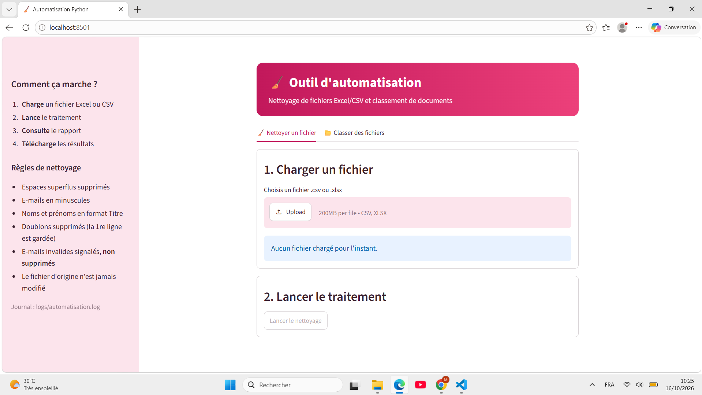
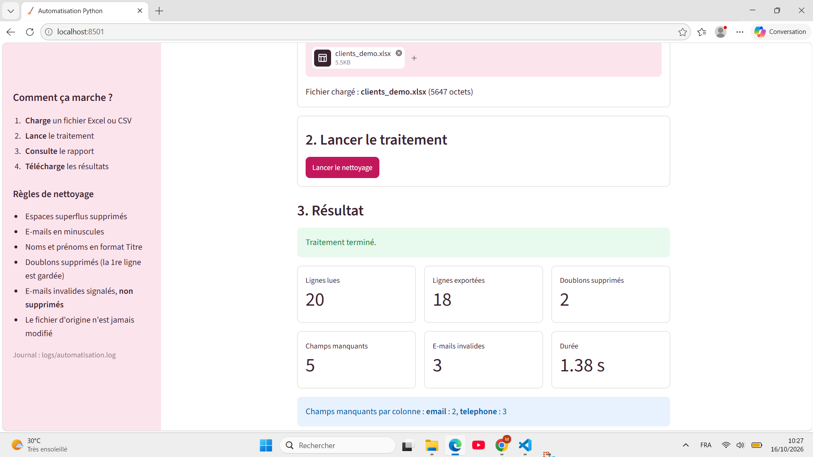
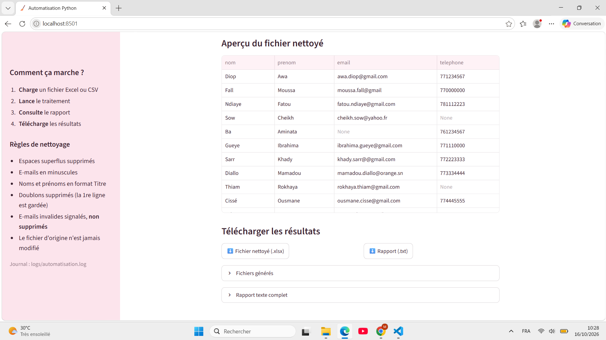
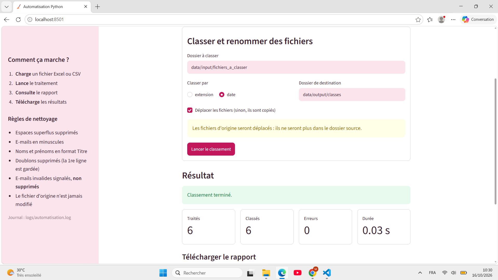
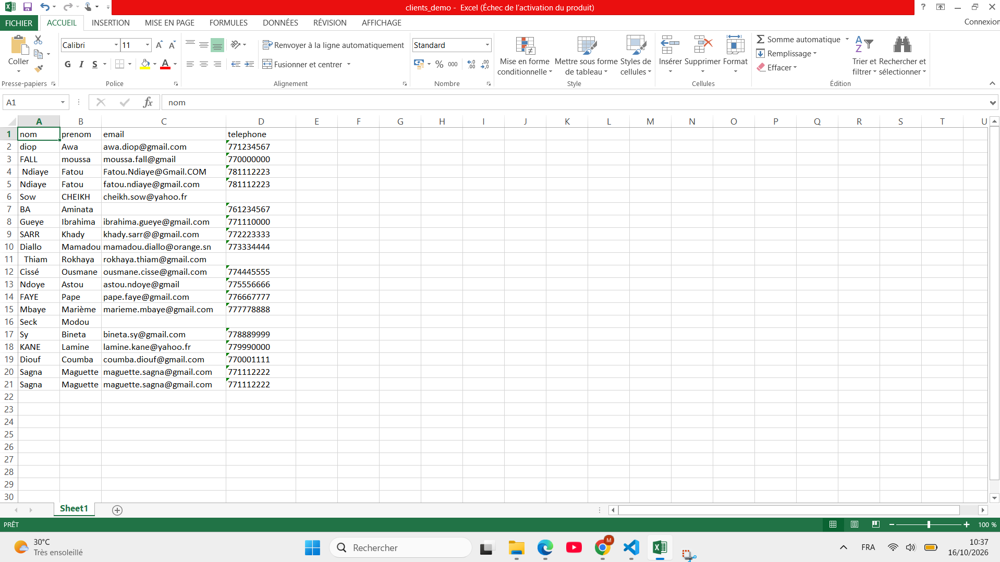
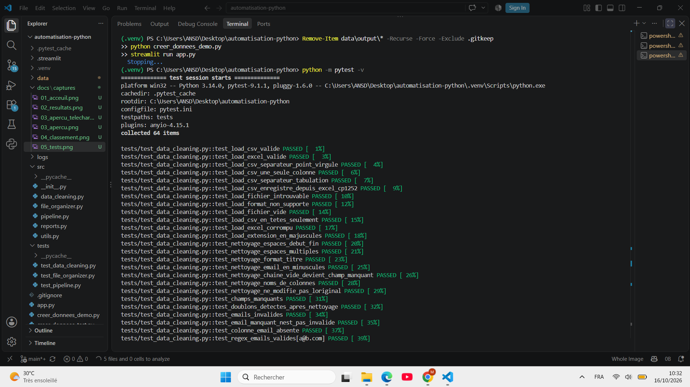
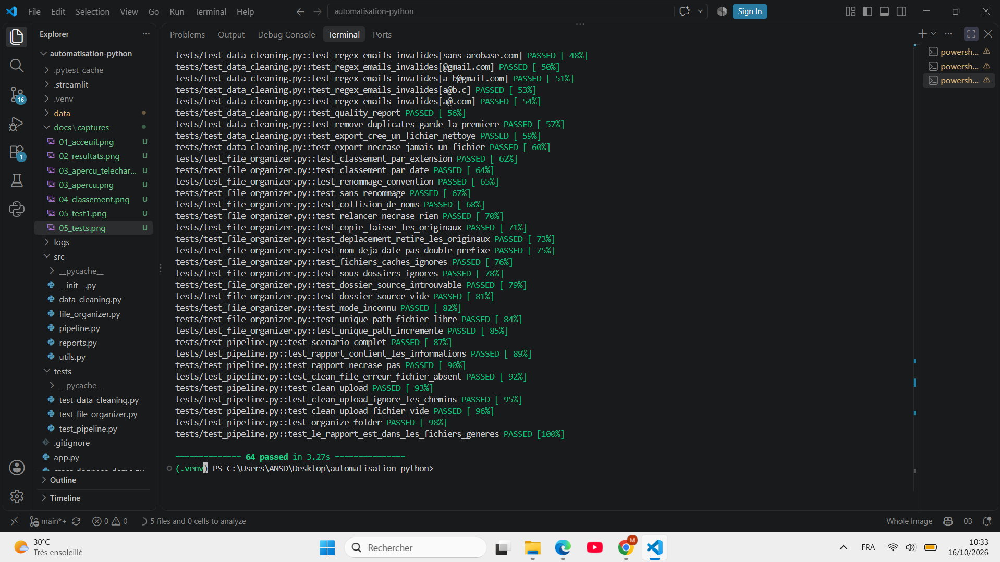

# Outil d'automatisation des tâches administratives avec Python

Projet de stage académique de deux semaines : un outil qui **nettoie des fichiers Excel/CSV**, **classe et renomme des fichiers** et produit un **rapport de traitement**, utilisable depuis une interface web locale ou en ligne de commande.

- **Auteur :** Magatte Sagna
- **Encadrant :** Abdou
- **Structure d'accueil :** Zion teranga
- **Période :** à partir du 08-10-2026

## Sommaire

1. [Présentation](#1-présentation)
2. [Fonctionnalités](#2-fonctionnalités)
3. [Aperçu](#3-aperçu)
4. [Prérequis](#4-prérequis)
5. [Installation](#5-installation)
6. [Lancement](#6-lancement)
7. [Guide d'utilisation](#7-guide-dutilisation)
8. [Règles de nettoyage](#8-règles-de-nettoyage)
9. [Jeux de démonstration](#9-jeux-de-démonstration)
10. [Architecture](#10-architecture)
11. [Tests](#11-tests)
12. [Journal et gestion des erreurs](#12-journal-et-gestion-des-erreurs)
13. [Limites connues](#13-limites-connues)
14. [Perspectives](#14-perspectives)
15. [Dépannage](#15-dépannage)

---

## 1. Présentation

Dans de nombreuses organisations, les listes de données (clients, employés, produits) sont encore vérifiées à la main : suppression des doublons, repérage des champs vides, contrôle des adresses e-mail, rangement des documents. Ces tâches sont longues et source d'erreurs.

Cet outil les automatise :

- il lit un fichier `.xlsx` ou `.csv`, le nettoie et signale les anomalies ;
- il exporte un **nouveau** fichier propre, **sans jamais modifier l'original** ;
- il classe et renomme des fichiers selon des règles simples, sans jamais écraser un fichier existant ;
- il produit un rapport (lignes traitées, anomalies, fichiers générés, durée) et tient un journal des opérations.

## 2. Fonctionnalités

| Module | Fonctionnalités |
|---|---|
| Importation | Lecture de fichiers `.xlsx` et `.csv` (séparateur `,` `;` ou tabulation, encodage UTF-8 ou Excel) |
| Nettoyage | Suppression des espaces superflus, e-mails en minuscules, noms et prénoms en format Titre |
| Contrôle qualité | Détection des doublons, des champs manquants et des e-mails invalides |
| Export | Création d'un fichier `xxx_nettoye.xlsx` sans écraser l'original |
| Gestion des fichiers | Classement par extension ou par date, renommage `AAAA-MM-JJ_nom.ext`, gestion des collisions de noms |
| Rapport | Bilan de traitement affiché et enregistré en `.txt` |
| Journalisation | Journal des opérations, avertissements et erreurs dans `logs/automatisation.log` |
| Interface | Application web locale (Streamlit) : chargement, traitement, indicateurs, téléchargement |

## 3. Aperçu

**Page d'accueil**



**Résultat d'un nettoyage**



**Graphique, aperçu du fichier nettoyé et téléchargements**



**Classement de fichiers**



**Fichier avant et après nettoyage**




**Tests automatiques**





## 4. Prérequis

- **Python 3.11 ou 3.12** recommandé (le projet a aussi été développé et testé avec Python 3.14 sous Windows).
- **Git** pour récupérer le projet.
- Un navigateur web pour l'interface.

Vérification :

```powershell
python --version
git --version
```

## 5. Installation

**1. Récupérer le projet**

```powershell
git clone https://github.com/MagatteSagna/automatisation-python.git
cd automatisation-python
```

**2. Créer et activer un environnement virtuel**

```powershell
python -m venv .venv
.venv\Scripts\Activate.ps1
```

Si PowerShell bloque l'activation, lancer une fois `Set-ExecutionPolicy -Scope CurrentUser RemoteSigned`.

**3. Installer les bibliothèques**

```powershell
pip install -r requirements.txt
```

Bibliothèques principales : pandas, openpyxl, streamlit, pytest.

## 6. Lancement

### Interface web (recommandé)

```powershell
streamlit run app.py
```

L'application s'ouvre sur `http://localhost:8501`. Pour l'arrêter, appuyer sur `Ctrl+C` dans le terminal.

### Ligne de commande

```powershell
# Nettoyer un fichier
python main.py nettoyer data/input/clients_demo.xlsx

# Classer les fichiers d'un dossier par extension ou par date
python main.py classer data/input/fichiers_a_classer --mode extension
python main.py classer data/input/fichiers_a_classer --mode date
```

Options : `--sortie DOSSIER` pour choisir le dossier de sortie, `--deplacer` pour déplacer les fichiers au lieu de les copier. `python main.py --help` affiche l'aide.

## 7. Guide d'utilisation

### Nettoyer un fichier (interface)

1. Ouvrir l'onglet **Nettoyer un fichier**.
2. Charger un fichier `.csv` ou `.xlsx`.
3. Cliquer sur **Lancer le nettoyage**.
4. Consulter les indicateurs, le graphique des anomalies et l'aperçu du fichier nettoyé.
5. Télécharger le **fichier nettoyé** et le **rapport**.

Les fichiers générés sont aussi enregistrés dans `data/output/`.

### Classer des fichiers (interface)

1. Ouvrir l'onglet **Classer des fichiers**.
2. Indiquer le dossier à classer et le dossier de destination.
3. Choisir le classement par **extension** ou par **date**.
4. Cliquer sur **Lancer le classement**. Par défaut, les fichiers sont **copiés** : les originaux restent en place.

### Exemple de rapport

```
=== RAPPORT DE TRAITEMENT ===
Date : 2026-10-15 11:08:24
Fichier source : clients_demo.xlsx
Lignes lues : 20
Lignes exportées : 18
Doublons supprimés : 2
Champs manquants : 5 (email : 2, telephone : 3)
E-mails invalides : 3
  (lignes Excel : 3, 9, 13)
Fichiers générés :
  - data/output/clients_demo_nettoye.xlsx
  - data/output/clients_demo_rapport.txt
Durée du traitement : 0.12 s
```

Les numéros de ligne correspondent à ceux affichés dans Excel (la ligne 1 contient les en-têtes).

## 8. Règles de nettoyage

| Règle | Exemple |
|---|---|
| Supprimer les espaces au début et à la fin | `"  Maguette  "` devient `"Maguette"` |
| Réduire les espaces multiples | `"Maguette      Sagna"` devient `"Maguette Sagna"` |
| Noms et prénoms en format Titre | `"SAGNA"` devient `"Sagna"` |
| E-mails en minuscules | `"SAGNAMAGUITA@GMAIL.COM"` devient `"sagnamaguita@gmail.com"` |
| Cellule vide = champ manquant | Comptabilisé dans le rapport |
| Doublon = ligne entièrement identique (après nettoyage) | La première est gardée, les autres sont supprimées |
| E-mail invalide = ne respecte pas `texte@domaine.ext` | Signalé dans le rapport, **conservé** dans le fichier exporté |

L'outil ne corrige pas les e-mails invalides : il ne peut pas deviner l'extension manquante (`@gmail` peut être `.com` ou autre chose). Il les signale pour qu'une personne décide.

## 9. Jeux de démonstration

Tous les fichiers sont **fictifs** : aucune donnée personnelle réelle.

| Fichier | Génération | Résultats attendus |
|---|---|---|
| `data/input/clients_test.csv` et `.xlsx` | `python creer_donnees_test.py` | 7 lignes lues, 6 exportées, 1 doublon, 3 champs manquants, 2 e-mails invalides (lignes Excel 3 et 8) |
| `data/input/clients_demo.csv` et `.xlsx` | `python creer_donnees_demo.py` | 20 lignes lues, 18 exportées, 2 doublons, 5 champs manquants, 3 e-mails invalides (lignes Excel 3, 9 et 13) |
| `data/input/fichiers_a_classer/` | `python creer_fichiers_a_classer.py` | 6 fichiers classés, 0 erreur |

Exemple de classement par extension :

| Fichier d'origine | Destination |
|---|---|
| `Liste Clients.xlsx` | `xlsx/2026-09-12_liste_clients.xlsx` |
| `liste_clients.xlsx` | `xlsx/2026-09-12_liste_clients_1.xlsx` (collision gérée) |
| `rapport.pdf` | `pdf/2026-09-30_rapport.pdf` |
| `LISEZMOI` | `sans_extension/2026-10-14_lisezmoi` |

## 10. Architecture

```
automatisation-python/
├── app.py                    # Interface Streamlit
├── main.py                   # Ligne de commande
├── src/
│   ├── data_cleaning.py      # Importation, nettoyage, contrôle qualité, export
│   ├── file_organizer.py     # Classement et renommage des fichiers
│   ├── reports.py            # Construction, mise en forme et enregistrement des rapports
│   ├── pipeline.py           # Moteur : enchaîne les étapes (utilisé par l'interface et la ligne de commande)
│   └── utils.py              # Journalisation et chemins sans écrasement
├── tests/                    # Tests automatiques (pytest)
├── data/
│   ├── input/                # Fichiers source et jeux de démonstration
│   └── output/               # Résultats générés
├── logs/                     # Journal des opérations
├── docs/captures/            # Captures d'écran du README
├── .streamlit/config.toml    # Thème de l'interface
├── pytest.ini
├── requirements.txt
└── README.md
```

**Principe :** l'interface (`app.py`) et la ligne de commande (`main.py`) ne contiennent aucune règle de nettoyage. Elles appellent le moteur (`pipeline.py`), qui utilise les modules `data_cleaning`, `file_organizer` et `reports`. Chaque module a une seule responsabilité, ce qui facilite les tests et la maintenance.

**Déroulement d'un nettoyage :**

```
Chargement du fichier -> lisible ? -- non --> message d'erreur + journal
                            | oui
                            v
        Nettoyage -> détection des anomalies -> export -> rapport + journal
```

## 11. Tests

```powershell
python -m pytest
```

64 tests automatiques vérifient :

- l'**importation** : fichiers valides (CSV, Excel, différents séparateurs et encodages), fichiers vides, fichiers mal formés, formats non supportés, fichiers introuvables ;
- le **nettoyage** et le **contrôle qualité** : espaces, format Titre, e-mails, doublons, champs manquants ;
- l'**export** et le **classement** : pas d'écrasement, collisions de noms, copie et déplacement, dates ;
- le **moteur de bout en bout** : scénario complet, rapport, fichier d'origine intact.

Les tests utilisent des dossiers temporaires : ils ne modifient jamais les fichiers du projet. Pour le détail : `python -m pytest -v`.

## 12. Journal et gestion des erreurs

Le journal `logs/automatisation.log` enregistre chaque opération avec la date, le niveau (`INFO`, `WARNING`, `ERROR`) et le module concerné. Il n'est pas versionné dans Git.

| Situation | Message affiché |
|---|---|
| Fichier introuvable | `Fichier introuvable : ...` |
| Format non supporté | `Format non supporté : .pdf (utiliser .csv ou .xlsx)` |
| Fichier vide | `Le fichier est vide.` |
| Fichier corrompu | `Fichier illisible ou corrompu : ...` |
| Dossier à classer introuvable | `Dossier source introuvable : ...` |
| Dossier sans fichier | `Le dossier ne contient aucun fichier à classer.` |
| Colonne `email` absente | Avertissement dans le journal, contrôle des e-mails ignoré |

## 13. Limites connues

- Les règles de nettoyage visent les colonnes nommées `nom`, `prenom` et `email` (un en-tête avec accent comme `prénom` n'est pas mis en format Titre).
- Le contrôle des e-mails vérifie la **forme** de l'adresse, pas son existence.
- Un doublon est une ligne **entièrement identique** après nettoyage.
- Pour un fichier Excel, seule la **première feuille** est lue.
- Le fichier nettoyé est toujours au format `.xlsx`, et le rapport est un fichier texte.
- L'interface fonctionne en **local** : le dossier à classer est un dossier de l'ordinateur qui exécute l'application.
- Le message d'un fichier corrompu se termine par un texte technique de la bibliothèque de lecture.
- L'interface n'est pas couverte par des tests automatiques ; elle a été vérifiée manuellement.

## 14. Perspectives

- Planification périodique des traitements.
- Notifications par e-mail à la fin d'un traitement.
- Choix des colonnes et des règles de nettoyage depuis l'interface.
- Export au format CSV et choix du format du rapport.
- Suggestion de correction pour les e-mails invalides, soumise à validation.
- Tests automatiques de l'interface.

## 15. Dépannage

| Problème | Solution |
|---|---|
| `streamlit` n'est pas reconnu | Utiliser `python -m streamlit run app.py`, et vérifier que `(.venv)` est affiché |
| `ModuleNotFoundError: No module named 'src'` | Lancer les commandes depuis la racine du projet |
| `ModuleNotFoundError: pandas` | L'environnement virtuel n'est pas activé, ou relancer `pip install -r requirements.txt` |
| `PermissionError` | Fermer le fichier Excel qui est ouvert |
| Les fichiers de sortie portent un numéro (`_1`, `_2`) | Comportement voulu : l'outil n'écrase jamais un fichier existant |
| L'activation de `.venv` est refusée dans PowerShell | `Set-ExecutionPolicy -Scope CurrentUser RemoteSigned` |

## Technologies

| Technologie | Rôle |
|---|---|
| Python | Langage principal |
| pandas | Lecture, nettoyage et analyse des données |
| openpyxl | Lecture et écriture des fichiers Excel |
| pathlib et shutil | Parcours, copie, déplacement et renommage des fichiers |
| logging | Journal des opérations et des erreurs |
| Streamlit | Interface web locale |
| pytest | Tests automatiques |
| Git et GitHub | Suivi des versions et sauvegarde du code |
